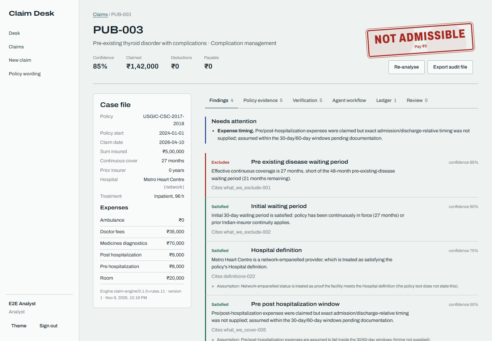
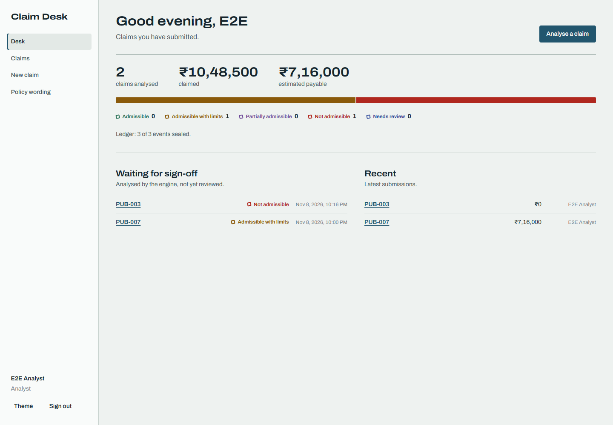
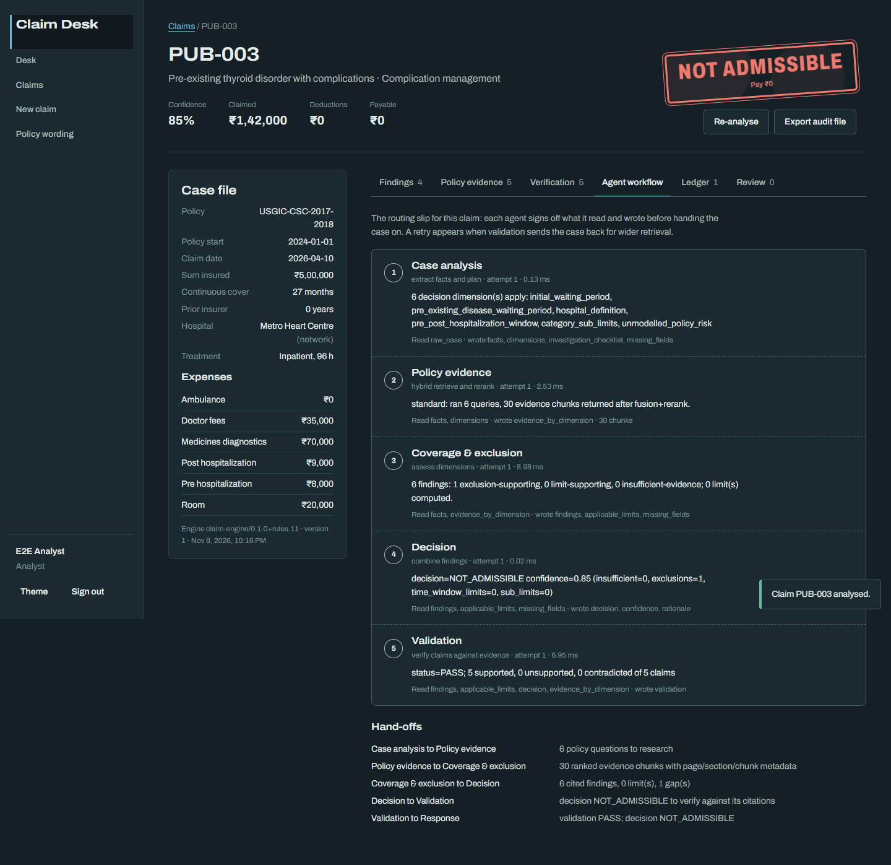
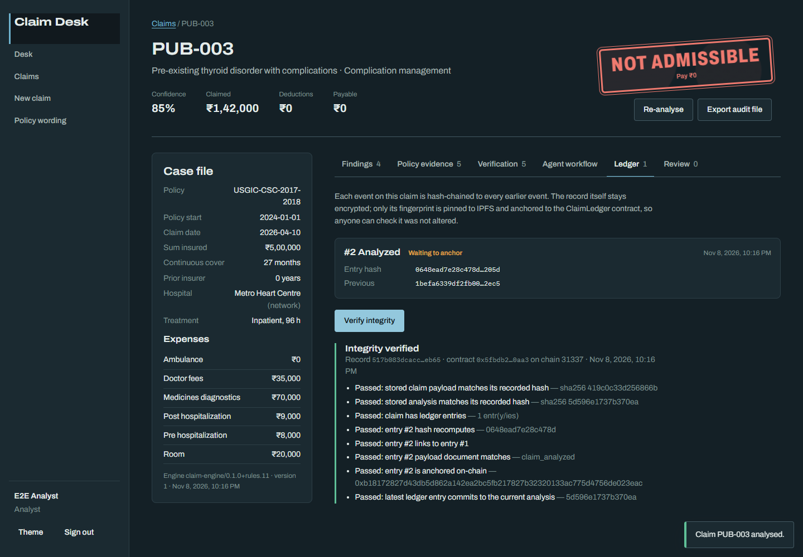
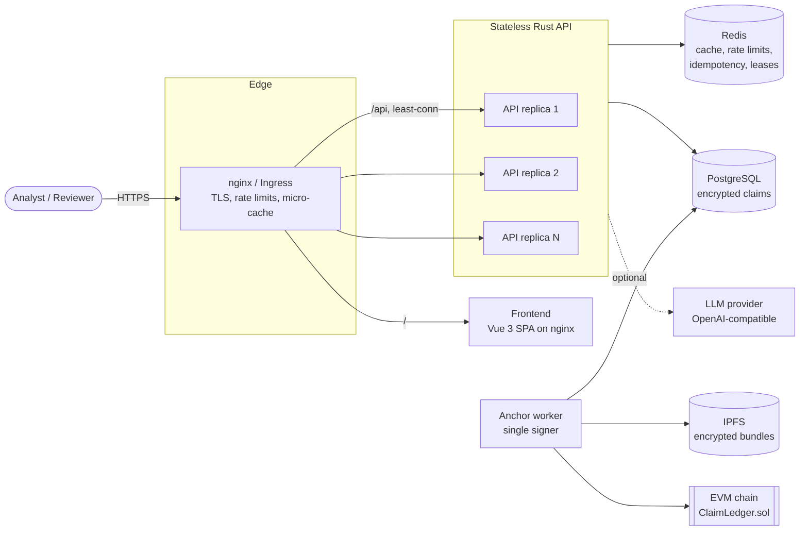
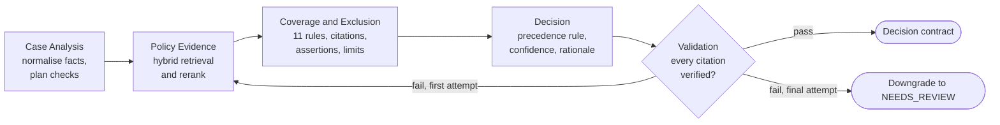
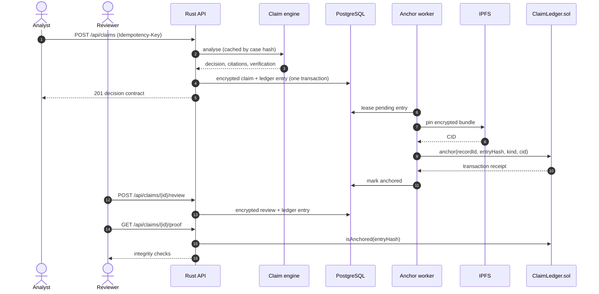
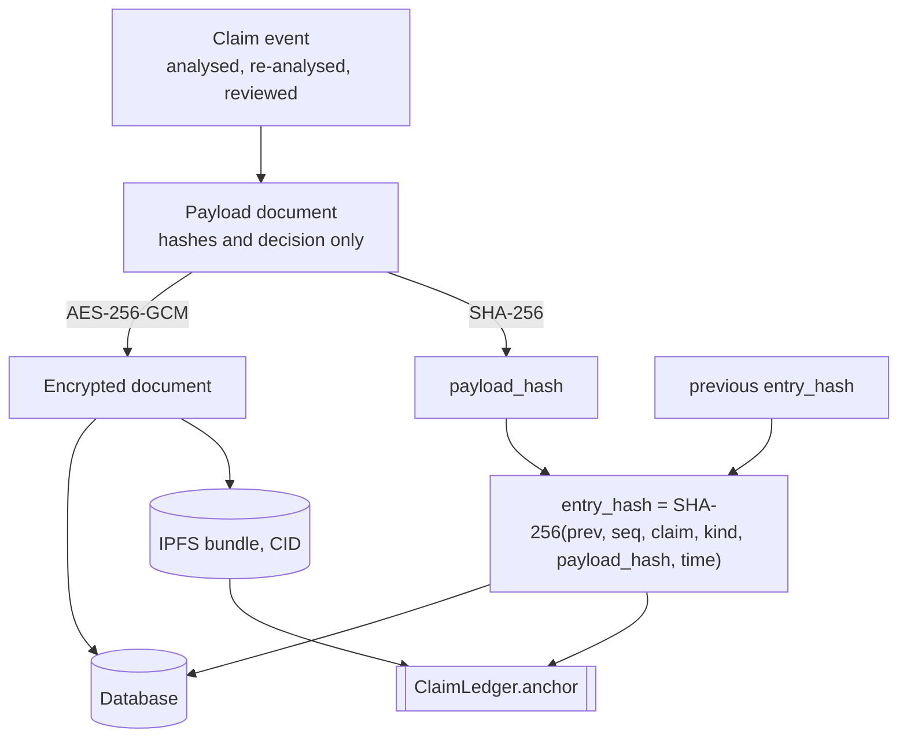
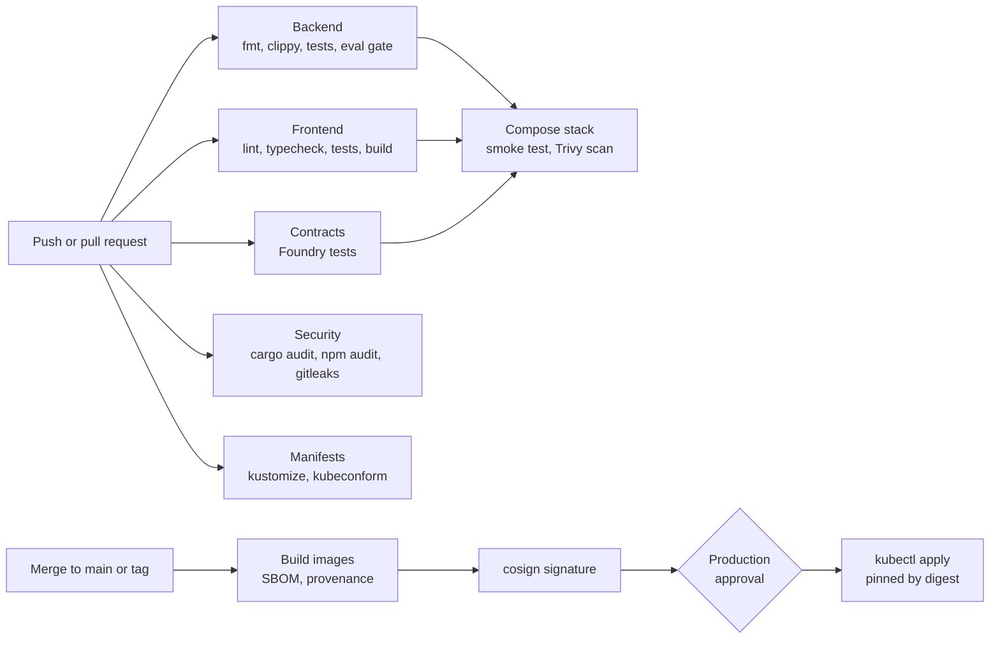

<div align="center">

# Claim Analyst Agent Workflow

**Policy-grounded, multi-agent health insurance claim adjudication with verifiable citations and a blockchain-anchored audit trail.**

[](https://github.com/Arfazrll/Claim-Analyst-Agent-Workflow/actions/workflows/ci.yml)
[](https://github.com/Arfazrll/Claim-Analyst-Agent-Workflow/actions/workflows/cd.yml)
[](LICENSE)

[](backend)
[](frontend)
[](frontend)
[](blockchain)
[](docker-compose.yml)
[](backend)
[](infra/redis)
[](docker-compose.yml)
[](docker-compose.yml)
[](infra/k8s)

[Overview](#overview) |
[Features](#features) |
[Architecture](#architecture) |
[Quick start](#quick-start) |
[Evaluation](#evaluation) |
[API](#api-reference) |
[Security](#security) |
[Deployment](#deployment)

</div>

---

## Overview

Claim Analyst Agent Workflow takes a structured health insurance claim and decides
whether it is admissible under a specific policy wording. Five specialised agents
extract the facts, retrieve the governing clauses, evaluate eleven coverage and exclusion
rules, combine the findings into a decision, and verify every citation against the
policy text. When the evidence does not support a safe conclusion, the system abstains
and holds the claim for a human reviewer instead of guessing.

Every analysis and review is encrypted at rest and sealed into a tamper-evident ledger.
Only cryptographic fingerprints are anchored to an EVM smart contract and the encrypted
bundles are pinned to IPFS, so anyone can prove a record was not altered without any
health data ever being published.

The project is a Rust and Vue re-engineering of
[aptino-claim-engine](https://github.com/ByteNinjaSmit/aptino-claim-engine) (Python,
FastAPI, Streamlit), extended from a stateless prototype into a multi-user, persistent,
horizontally scalable product. The policy chunks and labelled test cases originate from
that repository.

<p align="center">
  
</p>

## Features

| Area | Capability |
|---|---|
| Decision engine | Five-agent pipeline, eleven policy rules, numbers read from the retrieved clause, explicit abstention (`NEEDS_REVIEW`) |
| Evidence | Hybrid retrieval (TF-IDF vectors + BM25, reciprocal rank fusion, reranking) with per-stage ranks on every citation |
| Verification | Each claim checked as `SUPPORTED`, `UNSUPPORTED` or `CONTRADICTED`, including limit arithmetic; one widened retry, then downgrade |
| Optional LLM | OpenAI-compatible provider may rephrase findings or flag clauses for review; it can never approve, reject or change an amount |
| Review workflow | Analyst, reviewer and admin roles; four-eyes sign-off; override and escalation with mandatory reasons |
| Integrity | AES-256-GCM encryption at rest, hash-chained ledger, IPFS pinning, on-chain anchoring, per-claim integrity proofs |
| Performance | Redis-backed analysis cache, ETag and immutable asset caching, edge micro-cache, idempotent submissions |
| Protection | Sliding-window rate limiting, account lockout, CSRF double-submit tokens, strict CSP, rotating refresh tokens |
| Operations | Load-balanced API replicas, Docker Compose stack, Kubernetes manifests with autoscaling, CI/CD with signed images |

## Screenshots

<table>
  <tr>
    <td width="50%"><br><sub><b>Desk.</b> Decision mix, ledger status and the queue of claims waiting for sign-off.</sub></td>
    <td width="50%"><br><sub><b>Agent workflow.</b> The routing slip: what each agent read, wrote and handed on.</sub></td>
  </tr>
  <tr>
    <td width="50%"><br><sub><b>Decision.</b> The stamped outcome, the case file and every finding with its cited clause.</sub></td>
    <td width="50%"><br><sub><b>Ledger proof.</b> Hash chain links, IPFS pin and on-chain anchor, verified on demand.</sub></td>
  </tr>
</table>

## Architecture

### System topology



API replicas hold no session state: authentication uses signed cookies, shared state
lives in Redis and PostgreSQL, so the load balancer can route any request to any
replica. A single anchor worker signs blockchain transactions so one key never races
its own nonce.

### Agent pipeline



| Agent | Reads | Writes |
|---|---|---|
| Case Analysis | raw case | normalised facts, applicable rules, unknown and missing fields |
| Policy Evidence | facts, rules | ranked evidence per rule with per-stage retrieval scores |
| Coverage and Exclusion | facts, evidence | findings with machine-checkable assertions, deductions |
| Decision | findings, limits | decision, confidence, rationale (LLM phrasing is guarded) |
| Validation | full state | verdict per claim; downgrade when the evidence cannot be confirmed |

The eleven rules are: initial 30-day waiting period, first-year named-disease waiting
period, pre-existing disease waiting period, hospital definition, domiciliary
conditions, day care under 24 hours, pre/post-hospitalisation window, cosmetic
exclusion, experimental treatment, category sub-limits, and an unmodelled-risk safety
net. Each rule extracts its threshold from the retrieved clause and reports insufficient
evidence when the number is not present; nothing is hard-coded from outside knowledge.

### Claim lifecycle



### Why only fingerprints go on-chain

A public blockchain is replicated and immutable, so health data written to it could
never be deleted, which conflicts with privacy obligations. The ledger therefore keeps
data private and publishes proofs only:



Changing any past record breaks every later hash in the chain, and the on-chain anchor
proves when each entry existed. The chain is configurable: a local Anvil node for
development, the Sepolia testnet through a free public RPC for staging, or any EVM
network later.

## Repository layout

```
.
|-- backend/                    Rust workspace
|   |-- crates/engine/          Claim engine library: agents, rules, retrieval, verification, evaluation
|   |-- crates/api/             HTTP API: auth, persistence, cache, rate limiting, ledger, chain, IPFS
|   `-- data/                   Policy chunks and 29 labelled test cases
|-- frontend/                   Vue 3 + TypeScript single-page application
|-- blockchain/                 ClaimLedger smart contract, Foundry tests, deployer image
|-- infra/
|   |-- nginx/                  Edge reverse proxy and load balancer
|   |-- redis/                  Hardened Redis configuration
|   `-- k8s/                    Kustomize base with dev and prod overlays
|-- scripts/                    Secret generation and end-to-end smoke test
|-- docs/                       Architecture, security notes, screenshots
|-- .github/workflows/          CI and CD pipelines
`-- docker-compose.yml          Full local stack
```

## Technology stack

| Layer | Technology |
|---|---|
| Claim engine | Rust, regex, serde; deterministic, no model downloads |
| API | axum 0.8, tower-http, sqlx (`Any` driver), redis-rs, jsonwebtoken, argon2, aes-gcm |
| Blockchain client | alloy 1.x, Solidity 0.8.24, Foundry, Anvil |
| Storage | PostgreSQL 17 (replicas), SQLite (local development), IPFS Kubo |
| Cache and limits | Redis 7.4 with in-process fallback |
| Frontend | Vue 3, TypeScript, Vite, Pinia, vue-router, self-hosted Archivo and IBM Plex Mono |
| Edge | nginx (least connections, passive health checks, micro-cache), ingress-nginx |
| Delivery | Docker, Docker Compose, Kubernetes (kustomize), GitHub Actions, GHCR, cosign, Trivy |

## Quick start

### Full stack with Docker

Requirements: Docker with Compose v2, `make`, `openssl`.

```bash
git clone https://github.com/Arfazrll/Claim-Analyst-Agent-Workflow.git
cd Claim-Analyst-Agent-Workflow

make secrets     # writes .env with generated secrets and prints the admin sign-in
make up          # builds and starts the stack in the background
make smoke       # optional: end-to-end check of decision, ledger, IPFS and chain proof
```

Open http://localhost:8080 and sign in with the administrator printed by `make secrets`.

| Service | Purpose | Exposed |
|---|---|---|
| `edge` | nginx load balancer and reverse proxy | `localhost:8080` |
| `frontend` | Static single-page application | internal |
| `api` (x2) | Rust API replicas, anchor worker with leader lease | internal |
| `postgres` | Primary database | internal network only |
| `redis` | Cache, rate limits, idempotency keys | internal network only |
| `anvil` | Local EVM chain | internal |
| `contracts` | One-shot ClaimLedger deployment | runs once |
| `ipfs` | Kubo node for encrypted bundles | gateway on `localhost:8081` |

### Local development without Docker

Requirements: Rust (stable), Node.js 22.

```bash
# API on :8000 with SQLite and an in-process cache (no Redis or chain needed)
cd backend
ADMIN_EMAIL=admin@example.com ADMIN_PASSWORD='Choose-A-Strong-Pass-1' cargo run -p claim-api

# Frontend on :5173, proxying /api to :8000
cd frontend
npm install
npm run dev
```

To anchor locally, start `anvil`, run `blockchain/deploy.sh`, and set `CHAIN_ENABLED=true`,
`CHAIN_PRIVATE_KEY` and `CHAIN_DEPLOYMENT_FILE` for the API.

## Configuration

All settings are environment variables; see [`.env.example`](.env.example) and
[`backend/crates/api/src/config.rs`](backend/crates/api/src/config.rs).

| Variable | Default | Description |
|---|---|---|
| `DATABASE_URL` | `sqlite://data/claims.db?mode=rwc` | SQLite or `postgres://` connection string |
| `REDIS_URL` | unset (in-process cache) | Shared cache and rate-limit store |
| `JWT_SECRET` | required in production | At least 32 characters |
| `DATA_ENCRYPTION_KEY` | required in production | Base64 of 32 random bytes |
| `CORS_ORIGINS` | `http://localhost:5173,...` | Allowed origins for unsafe requests |
| `COOKIE_SECURE` | `true` in production | Set `false` only for plain HTTP development |
| `TRUST_PROXY` | `false` | Trust `X-Real-IP` from the edge proxy |
| `RATE_LIMIT_AUTH_PER_MIN` / `ANALYZE` / `API` | `10` / `30` / `300` | Sliding-window limits |
| `LLM_PROVIDER` | `offline` | `openai_compatible` to enable rationale phrasing |
| `CHAIN_ENABLED`, `CHAIN_RPC_URL`, `CHAIN_ID` | `false`, Anvil | EVM anchoring target |
| `CHAIN_CONTRACT_ADDRESS` / `CHAIN_DEPLOYMENT_FILE` | unset | Deployed ClaimLedger address |
| `IPFS_ENABLED`, `IPFS_API_URL` | `false`, `http://localhost:5001` | Bundle pinning |

## Evaluation

The engine ships with an offline, deterministic evaluation suite that gates every CI
build.

```bash
cd backend
cargo run -q -p claim-engine --bin claim-eval            # summary table
cargo run -q -p claim-engine --bin claim-eval -- --json  # full report
cargo run -q -p claim-engine --bin claim-eval -- --case PUB-007
```

| Metric | Result |
|---|---|
| Labelled decisions correct | 28 / 28 |
| Unsafe decisions (confident and wrong) | 0 |
| Required abstentions (`NEEDS_REVIEW`) caught | 10 / 10 |
| Exact payable deduction amounts | 11 / 11 |
| Claims verified against the cited clause | 139 / 139 |
| Injected faults detected by the verifier | 177 / 177 |
| Deterministic across repeated runs | Yes |
| Median latency per case | about 6 ms |

### Improvements over the reference implementation

| Area | Reference | This project |
|---|---|---|
| Paraphrased diagnoses | Detected only with an LLM | Deterministic clinical-synonym lexicon; can only hold a claim for review |
| False alarms | "Internal fixation" matched a tumour clause | Clauses owned by modelled rules are skipped; anatomical qualifiers ignored |
| Retrieval dependencies | Neural embedder and cross-encoder downloads | Pure Rust hybrid retrieval with assertion-aware evidence selection |
| Persistence | Stateless; reviews downloaded as JSON | Encrypted storage, server-side reviews, versioned re-analysis |
| Accountability | None | Accounts, roles, four-eyes review, audit log, export bundles |
| Integrity | None | Hash-chained ledger, IPFS, on-chain anchoring, integrity proofs |
| Operations | Single container | Load-balanced replicas, Redis, rate limiting, Kubernetes, CI/CD |

## API reference

| Method | Path | Role | Description |
|---|---|---|---|
| `POST` | `/api/auth/register`, `/login`, `/refresh`, `/logout` | public | Session management with HttpOnly cookies |
| `GET` | `/api/auth/me` | any | Current user |
| `POST` | `/api/auth/password` | any | Change password and revoke other sessions |
| `POST` | `/api/analyze` | any | Stateless decision contract, compatible with the reference API |
| `POST` | `/api/claims` | analyst | Analyse, encrypt, persist and append to the ledger |
| `GET` | `/api/claims` | any | List with decision, status and case ID filters |
| `GET` | `/api/claims/{id}` | owner or reviewer | Case, analysis, reviews and ledger entries |
| `POST` | `/api/claims/{id}/review` | reviewer | Agree, override or escalate |
| `POST` | `/api/claims/{id}/reanalyze` | owner or reviewer | New versioned analysis |
| `GET` | `/api/claims/{id}/proof` | owner or reviewer | End-to-end integrity proof |
| `GET` | `/api/claims/{id}/export` | owner or reviewer | Downloadable audit bundle |
| `GET` | `/api/policy/search`, `/chunks`, `/dimensions` | any | Policy explorer and rule catalogue |
| `GET` | `/api/ledger/status`, `/entries`, `/verify` | reviewer | Ledger, chain and IPFS status, full chain verification |
| `GET`, `PATCH` | `/api/admin/users`, `/api/admin/audit` | admin | Role management and audit log |
| `POST` | `/api/admin/eval` | reviewer | Run the evaluation suite |
| `GET` | `/healthz`, `/readyz`, `/metrics` | internal | Liveness, readiness, Prometheus metrics |

Example session with `curl` and `jq` (cookies plus the CSRF header for unsafe requests):

```bash
BASE=http://localhost:8080
curl -s -c jar -H 'Content-Type: application/json' -H "Origin: $BASE" \
  -d '{"email":"admin@example.com","password":"<admin-password>"}' $BASE/api/auth/login
CSRF=$(awk '$6 == "caw_csrf" {print $7}' jar)

jq '.[0]' backend/data/cases/public_cases.json > case.json   # PUB-001
curl -s -b jar -H 'Content-Type: application/json' -H "X-CSRF-Token: $CSRF" -H "Origin: $BASE" \
  -d @case.json $BASE/api/analyze
```

Abridged response:

```json
{
  "case_id": "PUB-001",
  "decision": "ADMISSIBLE_WITH_LIMITS",
  "confidence": 0.8,
  "amounts": { "claimed_total_inr": 163200, "total_deductions_inr": 10200, "estimated_payable_inr": 153000 },
  "applicable_limits": [
    { "description": "Room/boarding/nursing sub-limit (1% of Basic Sum Insured per day x 4 day(s) = INR 20,000)", "deduction_inr": 10000 },
    { "description": "Ambulance charges sub-limit (lower of 1% of Basic Sum Insured and INR 1,000 = INR 1,000)", "deduction_inr": 200 }
  ],
  "validation": { "status": "PASS", "counts": { "SUPPORTED": 7, "UNSUPPORTED": 0, "CONTRADICTED": 0 } },
  "citations": [{ "claim": "30-day initial waiting period and continuity exceptions", "section": "What We Exclude", "page": 9, "chunk_id": "what_we_exclude-002" }]
}
```

## Security

| Control | Implementation |
|---|---|
| Data at rest | AES-256-GCM with per-record associated data; no personal data on-chain |
| Passwords | Argon2id, strength policy, timing-equalised login, lockout after five failures |
| Sessions | 15-minute JWT in HttpOnly SameSite=Strict cookie; hashed, rotating refresh tokens with reuse detection |
| CSRF | Double-submit token bound to the signed session, plus an Origin allow-list |
| Authorisation | Role hierarchy, ownership checks returning 404, four-eyes review |
| Abuse | Redis sliding-window rate limits per bucket, edge limits, request size and time limits |
| Browser | Strict CSP without inline scripts, HSTS, frame denial, nosniff, referrer and permissions policies |
| LLM | Model output cannot change outcomes or amounts; fuzzed with hostile replies on all cases |
| Containers | Distroless non-root API, unprivileged nginx, read-only filesystems, all capabilities dropped |
| Kubernetes | Restricted Pod Security Standard, default-deny NetworkPolicies, no service account tokens |
| Supply chain | cargo-audit, npm audit, Trivy, gitleaks, Dependabot, SBOM, provenance, cosign signatures |

The full threat model is in [docs/SECURITY.md](docs/SECURITY.md).

## Testing

```bash
make test-backend     # rustfmt, clippy with warnings as errors, 49 Rust tests
make test-frontend    # ESLint, vue-tsc, Vitest
make test-contracts   # Foundry unit and fuzz tests
make eval             # evaluation gate
```

The API integration tests exercise CSRF enforcement, role-based access, four-eyes
review, ledger tamper detection, rate limiting, login lockout, refresh-token rotation,
idempotency, validation errors and security headers against an in-memory database.

## Deployment

### Kubernetes

```bash
cp infra/k8s/overlays/dev/secrets.env.example infra/k8s/overlays/dev/secrets.env   # fill in values
kubectl apply -k infra/k8s/overlays/dev     # local cluster with an Anvil chain
kubectl apply -k infra/k8s/overlays/prod    # Sepolia testnet anchoring
```

The base provides API, worker and frontend Deployments with probes, resource limits,
HorizontalPodAutoscalers, PodDisruptionBudgets, topology spread, an ingress with TLS and
rate limiting, PostgreSQL, Redis, IPFS and NetworkPolicies.

### CI/CD pipeline



To enable deployment, set the repository variable `DEPLOY_ENABLED=true` and the secrets
`KUBE_CONFIG` (base64 kubeconfig) and `PROD_SECRETS_ENV` (contents of `secrets.env`), and
add protection rules to the `production` environment.

## Documentation

* [Architecture](docs/ARCHITECTURE.md): agents, retrieval, ledger design, caching, load balancing
* [Security](docs/SECURITY.md): threat model and controls
* [Smart contract](blockchain/src/ClaimLedger.sol): append-only registry of claim-event fingerprints

## Known limitations

* The rule set targets a single policy wording and its clause structure.
* Retrieval is lexical; large or heterogeneous policy libraries would benefit from an embedding model.
* Labels reflect a reading of the policy, not an insurer's adjudication, and 28 labelled cases is a small sample.
* A domiciliary claim without a stated treatment duration (ADV-003) is not held for review unless the optional LLM step is enabled, to remain consistent with the PUB-004 label.

## Acknowledgements

Policy chunks and labelled cases are derived from
[aptino-claim-engine](https://github.com/ByteNinjaSmit/aptino-claim-engine). The policy
wording is the Universal Sompo CSC Individual Health Insurance (2017-2018) document.

## License

Released under the [MIT License](LICENSE).
